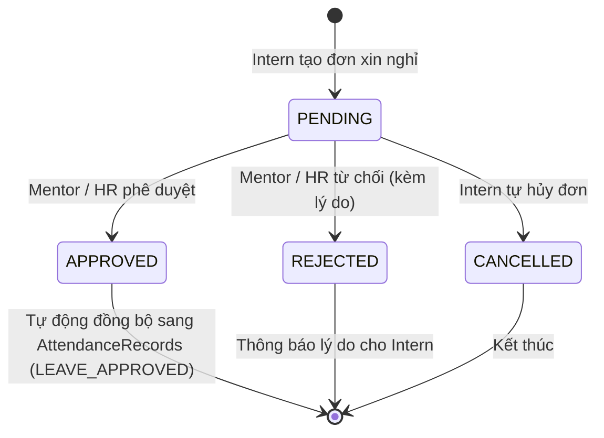

# TÀI LIỆU PHÂN TÍCH NGHIỆP VỤ: ĐĂNG KÝ NGHỈ PHÉP CHO THỰC TẬP SINH
**Mã công việc (Jira Subtask)**: `K10S6N1-135`  
**User Story cha**: `K10S6N1-101` (*"Là Intern, tôi muốn đăng ký nghỉ phép để ghi nhận thời gian nghỉ trong quá trình thực tập."*)  
**Module**: Quản lý Nghỉ phép (Leave Management)  
**Tác giả**: Huy (Team K10S6_N1)  
**Ngày lập**: 15/10/2026  
**Trạng thái**: Đã phân tích chi tiết (Sẵn sàng triển khai Backend `K10S6N1-136` và Frontend)

---

## 1. Mục tiêu và Phạm vi Phân tích (Objectives & Scope)

### 1.1. Mục tiêu
- Phân tích và làm rõ toàn bộ **luồng quy trình (workflow)** đăng ký và quản lý đơn xin nghỉ phép của Thực tập sinh (Intern).
- Xác định chi tiết **cấu trúc dữ liệu (Data Model & Schema)** của bảng đơn nghỉ phép `dbo.LeaveRequests`.
- Thiết lập các **quy tắc nghiệp vụ (Business Rules) và ràng buộc hợp lệ (Validation Rules)** nhằm tránh nộp trùng lặp, sai lệch thời gian hoặc vi phạm kỳ thực tập.
- Thiết kế **đặc tả API (API Contract)** chuẩn bị đầu vào cho subtask tiếp theo `K10S6N1-136` (*BE: Xây API tạo và xem đơn nghỉ phép*).

### 1.2. Phạm vi (Scope)
- **Đối tượng chính**: 
  - `INTERN`: Người tạo đơn xin nghỉ phép, xem lịch sử đơn, hủy đơn khi chưa duyệt.
  - `MENTOR` & `HR`: Người tiếp nhận, xem xét và phê duyệt/từ chối đơn nghỉ phép.
- **Tích hợp liên kết**:
  - Module Điểm danh & Chấm công (`dbo.AttendanceRecords`): Tự động ghi nhận ca làm việc `LEAVE_APPROVED` khi đơn được duyệt.
  - Module Thông báo (`dbo.Notifications`): Gửi thông báo khi đơn được nộp, duyệt hoặc từ chối.

---

## 2. Quy tắc Nghiệp vụ và Phân loại (Business Rules)

### 2.1. Phân loại hình thức và thời gian nghỉ
1. **Loại nghỉ phép (`LeaveType`)**:
   - `SICK_LEAVE` (Nghỉ ốm / Khám chữa bệnh): Có thể đính kèm thông tin bệnh án / tình trạng sức khỏe.
   - `ACADEMIC_LEAVE` (Nghỉ học tập / Thi cử tại trường): Lịch thi, lịch học quân sự, bảo vệ đồ án.
   - `PERSONAL_LEAVE` (Nghỉ việc cá nhân / Gia đình): Giải quyết việc riêng của cá nhân hoặc gia đình.
   - `OTHER` (Lý do khác): Cần ghi chú rõ ràng lý do cụ thể.
2. **Hình thức thời gian nghỉ (`DurationType`)**:
   - `FULL_DAY` (Cả ngày): 1 ngày làm việc chuẩn (8.0 giờ).
   - `MORNING` (Nửa ngày ca sáng): 08:00 - 12:00 (4.0 giờ, tính 0.5 ngày).
   - `AFTERNOON` (Nửa ngày ca chiều): 13:30 - 17:30 (4.0 giờ, tính 0.5 ngày).
   - `MULTI_DAY` (Nhiều ngày liên tiếp): Tính từ `StartDate` đến `EndDate`.

### 2.2. Các ràng buộc hợp lệ (Validation Rules)
1. **Ràng buộc thời gian**:
   - Ngày nghỉ (`StartDate`, `EndDate`) phải nằm trong thời gian diễn ra kỳ thực tập của sinh viên (`InternshipPrograms.StartDate` $\le$ `StartDate` $\le$ `EndDate` $\le$ `InternshipPrograms.EndDate`).
   - `EndDate` phải lớn hơn hoặc bằng `StartDate` (`EndDate >= StartDate`).
   - Nếu chọn `MORNING`, `AFTERNOON` hoặc `FULL_DAY` thì `StartDate` phải bằng `EndDate` (`TotalDays` = 0.5 hoặc 1.0).
2. **Ràng buộc chống trùng lặp**:
   - Sinh viên không được phép tạo đơn nghỉ trùng vào các ngày đã có đơn nghỉ phép ở trạng thái `PENDING` (chờ duyệt) hoặc `APPROVED` (đã duyệt).
3. **Ràng buộc lý do**:
   - Lý do xin nghỉ (`Reason`) bắt buộc phải nhập, tối thiểu 10 ký tự, tối đa 1000 ký tự.
4. **Quyền hủy đơn**:
   - Intern chỉ được phép tự hủy đơn (`CANCELLED`) khi đơn đang ở trạng thái `PENDING`. Khi đơn đã được duyệt hoặc bị từ chối thì không thể tự hủy.

---

## 3. Cấu trúc Dữ liệu Bảng `dbo.LeaveRequests` (Database Schema)

```sql
IF OBJECT_ID(N'dbo.LeaveRequests', N'U') IS NULL
BEGIN
    CREATE TABLE dbo.LeaveRequests (
        Id BIGINT IDENTITY(1,1) NOT NULL CONSTRAINT PK_LeaveRequests PRIMARY KEY,
        InternId INT NOT NULL CONSTRAINT FK_LeaveRequests_Interns REFERENCES dbo.Interns(Id) ON DELETE CASCADE,
        UserId INT NOT NULL CONSTRAINT FK_LeaveRequests_Users REFERENCES dbo.Users(Id),
        LeaveType VARCHAR(30) NOT NULL CONSTRAINT CK_LeaveRequests_Type CHECK (LeaveType IN ('SICK_LEAVE', 'ACADEMIC_LEAVE', 'PERSONAL_LEAVE', 'OTHER')),
        DurationType VARCHAR(20) NOT NULL CONSTRAINT CK_LeaveRequests_Duration CHECK (DurationType IN ('FULL_DAY', 'MORNING', 'AFTERNOON', 'MULTI_DAY')),
        StartDate DATE NOT NULL,
        EndDate DATE NOT NULL,
        TotalDays DECIMAL(3,1) NOT NULL CONSTRAINT CK_LeaveRequests_Days CHECK (TotalDays > 0 AND TotalDays <= 30.0),
        Reason NVARCHAR(1000) NOT NULL,
        Status VARCHAR(20) NOT NULL CONSTRAINT DF_LeaveRequests_Status DEFAULT 'PENDING' CONSTRAINT CK_LeaveRequests_Status CHECK (Status IN ('PENDING', 'APPROVED', 'REJECTED', 'CANCELLED')),
        ReviewerId INT NULL CONSTRAINT FK_LeaveRequests_Reviewer REFERENCES dbo.Users(Id),
        ReviewerNote NVARCHAR(1000) NULL,
        ReviewedAt DATETIME2 NULL,
        CreatedAt DATETIME2 NOT NULL CONSTRAINT DF_LeaveRequests_CreatedAt DEFAULT SYSUTCDATETIME(),
        UpdatedAt DATETIME2 NOT NULL CONSTRAINT DF_LeaveRequests_UpdatedAt DEFAULT SYSUTCDATETIME(),
        CONSTRAINT CK_LeaveRequests_DateRange CHECK (StartDate <= EndDate)
    );

    -- Chỉ mục phục vụ tìm kiếm lịch sử theo sinh viên và lọc trạng thái
    CREATE NONCLUSTERED INDEX IX_LeaveRequests_InternId_Status_Dates 
    ON dbo.LeaveRequests (InternId, Status, StartDate, EndDate)
    INCLUDE (LeaveType, DurationType, TotalDays, CreatedAt);
END;
```

---

## 4. Vòng đời và Luồng Nghiệp vụ (Leave Request Lifecycle & Workflow)



### 4.1. Chi tiết từng bước trong luồng:
1. **Khởi tạo đơn (Create)**:
   - Intern vào giao diện xin nghỉ phép, nhập thông tin: Loại nghỉ, hình thức, ngày bắt đầu, ngày kết thúc, lý do.
   - Hệ thống kiểm tra validation $\rightarrow$ lưu vào CSDL với trạng thái `PENDING`.
   - Hệ thống gửi thông báo nội bộ tới Mentor phụ trách (hoặc HR nếu chưa có Mentor).
2. **Xem danh sách & Lịch sử (Read & Tracking)**:
   - Intern xem bảng lịch sử các đơn đã nộp kèm trạng thái trực quan:
     - 🟡 **Chờ duyệt (`PENDING`)**: Đang chờ phản hồi.
     - 🟢 **Đã duyệt (`APPROVED`)**: Được phép nghỉ.
     - 🔴 **Bị từ chối (`REJECTED`)**: Kèm nhận xét/lý do từ chối.
     - ⚪ **Đã hủy (`CANCELLED`)**: Đơn sinh viên tự hủy.
3. **Hủy đơn (Cancel)**:
   - Nếu thay đổi kế hoạch và đơn vẫn đang `PENDING`, Intern bấm nút "Hủy đơn" $\rightarrow$ trạng thái chuyển thành `CANCELLED`.
4. **Phê duyệt & Đồng bộ (Approve / Reject)**:
   - Mentor hoặc HR xem đơn trong màn hình duyệt.
   - Nếu duyệt (`APPROVED`):
     - Cập nhật `ReviewerId`, `ReviewedAt`, trạng thái `APPROVED`.
     - Tự động tạo hoặc cập nhật bản ghi chấm công trong bảng `dbo.AttendanceRecords` cho ngày nghỉ với `Status = 'LEAVE_APPROVED'`.
     - Gửi thông báo chúc mừng tới Intern.
   - Nếu từ chối (`REJECTED`):
     - Bắt buộc nhập nhận xét/lý do từ chối (`ReviewerNote`).
     - Gửi thông báo từ chối kèm lý do phản hồi cho Intern.

---

## 5. Đặc tả API Sơ bộ (Cơ sở kỹ thuật cho Subtask K10S6N1-136)

### 5.1. `POST /api/interns/me/leave-requests` (Tạo đơn nghỉ phép mới)
- **Xác thực**: Yêu cầu Bearer Token vai trò `INTERN`.
- **Request Body**:
```json
{
  "leaveType": "SICK_LEAVE",
  "durationType": "FULL_DAY",
  "startDate": "2026-10-20",
  "endDate": "2026-10-20",
  "reason": "Em bị sốt xuất huyết cần nghỉ ngơi và điều trị tại nhà theo chỉ định của bác sĩ."
}
```
- **Response `201 Created`**:
```json
{
  "id": 101,
  "internId": 1,
  "leaveType": "SICK_LEAVE",
  "durationType": "FULL_DAY",
  "startDate": "2026-10-20",
  "endDate": "2026-10-20",
  "totalDays": 1.0,
  "reason": "Em bị sốt xuất huyết cần nghỉ ngơi và điều trị tại nhà theo chỉ định của bác sĩ.",
  "status": "PENDING",
  "createdAt": "2026-10-15T08:30:00Z"
}
```
- **Mã lỗi**: `400 Bad Request` (trùng ngày, sai định dạng ngày, lý do quá ngắn), `401 Unauthorized`.

### 5.2. `GET /api/interns/me/leave-requests` (Xem danh sách đơn của tôi)
- **Xác thực**: Bearer Token vai trò `INTERN`.
- **Query Params**: `status` (`ALL`, `PENDING`, `APPROVED`, `REJECTED`, `CANCELLED`), `page`, `pageSize`.
- **Response `200 OK`**:
```json
{
  "total": 5,
  "pendingCount": 1,
  "approvedCount": 3,
  "rejectedCount": 1,
  "items": [
    {
      "id": 101,
      "leaveType": "SICK_LEAVE",
      "leaveTypeLabel": "Nghỉ ốm / Khám bệnh",
      "durationType": "FULL_DAY",
      "startDate": "2026-10-20",
      "endDate": "2026-10-20",
      "totalDays": 1.0,
      "reason": "Em bị sốt xuất huyết...",
      "status": "PENDING",
      "statusLabel": "Chờ duyệt",
      "reviewerName": null,
      "reviewerNote": null,
      "createdAt": "2026-10-15T08:30:00Z"
    }
  ]
}
```

### 5.3. `POST /api/interns/me/leave-requests/{id}/cancel` (Hủy đơn khi còn chờ duyệt)
- **Xác thực**: Bearer Token vai trò `INTERN`.
- **Response `200 OK`**:
```json
{
  "success": true,
  "id": 101,
  "status": "CANCELLED",
  "message": "Đã hủy đơn xin nghỉ phép thành công."
}
```
- **Mã lỗi**: `400 Bad Request` (đơn đã được duyệt hoặc bị từ chối thì không thể hủy), `404 Not Found`.

---

## 6. Tiêu chí Nghiệm thu (Acceptance Criteria - AC)
- **AC-1**: Thực tập sinh có thể nộp đơn xin nghỉ phép với đầy đủ các loại nghỉ và hình thức thời gian (nửa ngày sáng/chiều, cả ngày, nhiều ngày).
- **AC-2**: Hệ thống kiểm tra và chặn nộp đơn nếu ngày nghỉ trùng với đơn khác đã nộp trước đó.
- **AC-3**: Sinh viên có thể xem danh sách lịch sử tất cả các đơn xin nghỉ phép của mình kèm trạng thái và phản hồi của người duyệt.
- **AC-4**: Sinh viên có thể tự bấm hủy đơn nếu đơn vẫn đang ở trạng thái Chờ duyệt (`PENDING`).
- **AC-5**: Đơn sau khi được duyệt tự động đồng bộ sang bảng chấm công để ghi nhận ca làm việc có phép (`LEAVE_APPROVED`).
