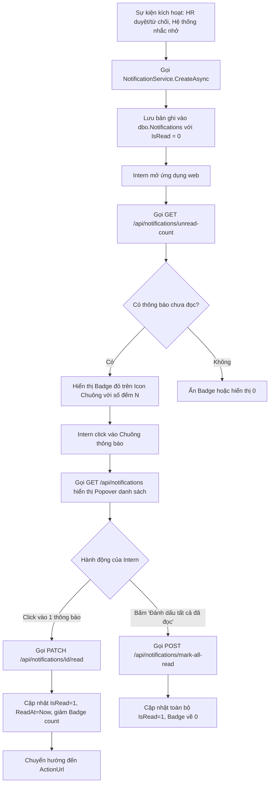

# TÀI LIỆU PHÂN TÍCH NGHIỆP VỤ: HỆ THỐNG THÔNG BÁO CHO THỰC TẬP SINH
**Mã công việc (Jira Subtask)**: `K10S6N1-155`  
**User Story cha**: `K10S6N1-106` (*"Là Intern, tôi muốn nhận thông báo trong hệ thống để biết các hoạt động và thay đổi liên quan đến quá trình thực tập của mình."*)  
**Module**: Notification System (Hệ thống Thông báo)  
**Tác giả**: Huy (Team K10S6_N1)  
**Ngày lập**: 14/10/2026  
**Trạng thái**: Đã phân tích chi tiết (Sẵn sàng triển khai BE `K10S6N1-156` và FE `K10S6N1-157`)

---

## 1. Mục tiêu và Phạm vi Phân tích (Objectives & Scope)

### 1.1. Mục tiêu
- Định nghĩa đầy đủ các sự kiện nghiệp vụ (Events/Triggers) trong toàn bộ quy trình thực tập của sinh viên phát sinh thông báo.
- Thiết kế mô hình dữ liệu (Data Model & Schema) lưu trữ thông báo tối ưu hiệu năng và khả năng mở rộng.
- Chuẩn hóa luồng gửi - nhận - hiển thị và xử lý tương tác thông báo của Thực tập sinh (Intern).
- Cung cấp hợp đồng giao tiếp API (API Contract) và đặc tả UI để làm căn cứ kỹ thuật cho subtask BE `K10S6N1-156` và FE `K10S6N1-157`.

### 1.2. Phạm vi (Scope)
- **Đối tượng thụ hưởng chính**: Tài khoản có vai trò `INTERN`.
- **Kênh thông báo**: Thông báo nội bộ trong ứng dụng web (In-app Notification: Chuông thông báo, Popover danh sách, Badge số lượng chưa đọc).
- **Phạm vi nghiệp vụ liên kết**: 
  - Điểm danh & Chấm công (Attendance & Leave Request).
  - Xét duyệt hồ sơ & tài liệu thực tập (CV, Đơn xin thực tập).
  - Hợp đồng thực tập (Internship Contracts).
  - Phân công người hướng dẫn (Mentor Assignment) & Kỳ thực tập (Program Schedule).
  - Thông báo chung từ Quản trị viên/Nhân sự (System/HR Announcements).

---

## 2. Xác định Sự kiện Kích hoạt Thông báo (Notification Triggers & Events)

| STT | Mã Sự kiện (Event Type) | Nhóm (Category) | Mô tả sự kiện kích hoạt | Người gửi (Actor) | Mức độ (Priority) | URL Điều hướng (Action URL) |
| :---: | :--- | :--- | :--- | :---: | :---: | :--- |
| **01** | `DOCUMENT_APPROVED` | `DOCUMENT` | HR duyệt CV hoặc Đơn xin thực tập của sinh viên. | HR | `SUCCESS` | `/pages/internship-profile.html` |
| **02** | `DOCUMENT_REJECTED` | `DOCUMENT` | HR từ chối tài liệu hồ sơ, kèm lý do cần sửa đổi. | HR | `DANGER` | `/pages/internship-profile.html` |
| **03** | `CONTRACT_ISSUED` | `CONTRACT` | HR tạo mới hợp đồng thực tập và yêu cầu xác nhận. | HR | `WARNING` | `/pages/intern-contract.html` |
| **04** | `CONTRACT_CONFIRMED` | `CONTRACT` | Hợp đồng thực tập đã được các bên xác nhận hợp lệ. | HR / System | `SUCCESS` | `/pages/intern-contract.html` |
| **05** | `MENTOR_ASSIGNED` | `ASSIGNMENT` | HR phân công Mentor hướng dẫn cho thực tập sinh. | HR | `INFO` | `/pages/mentor-assignment.html` |
| **06** | `SCHEDULE_UPDATED` | `PROGRAM` | Kỳ thực tập thay đổi thời gian (ngày bắt đầu/kết thúc). | HR / Admin | `INFO` | `/pages/intern-schedule.html` |
| **07** | `CHECKIN_REMINDER` | `ATTENDANCE` | Hệ thống nhắc nhở chấm công đầu ca làm việc (08:00 - 08:30). | System | `WARNING` | `/pages/intern-attendance.html` |
| **08** | `CHECKOUT_REMINDER` | `ATTENDANCE` | Hệ thống nhắc nhở chấm công kết thúc ca (17:00 - 17:30). | System | `WARNING` | `/pages/intern-attendance.html` |
| **09** | `LEAVE_APPROVED` | `ATTENDANCE` | Đơn xin nghỉ phép của Intern được duyệt (bởi Mentor/HR). | Mentor / HR | `SUCCESS` | `/pages/intern-attendance.html` |
| **10** | `LEAVE_REJECTED` | `ATTENDANCE` | Đơn xin nghỉ phép bị từ chối kèm lý do phản hồi. | Mentor / HR | `DANGER` | `/pages/intern-attendance.html` |
| **11** | `SYSTEM_ANNOUNCEMENT` | `SYSTEM` | Thông báo chung từ Ban nhân sự (nghỉ lễ, lịch họp...). | Admin / HR | `INFO` | `/pages/dashboard.html` |

---

## 3. Cấu trúc Dữ liệu Thông báo (Data Model & Schema)

### 3.1. Bảng `dbo.Notifications` trong SQL Server

```sql
IF OBJECT_ID(N'dbo.Notifications', N'U') IS NULL
BEGIN
    CREATE TABLE dbo.Notifications (
        Id BIGINT IDENTITY(1,1) NOT NULL CONSTRAINT PK_Notifications PRIMARY KEY,
        UserId INT NOT NULL CONSTRAINT FK_Notifications_Users REFERENCES dbo.Users(Id) ON DELETE CASCADE,
        Title NVARCHAR(200) NOT NULL,
        Message NVARCHAR(1000) NOT NULL,
        Category VARCHAR(50) NOT NULL CONSTRAINT CK_Notifications_Category CHECK (Category IN ('ATTENDANCE', 'DOCUMENT', 'CONTRACT', 'ASSIGNMENT', 'PROGRAM', 'SYSTEM')),
        Type VARCHAR(50) NOT NULL,
        Priority VARCHAR(20) NOT NULL CONSTRAINT DF_Notifications_Priority DEFAULT 'INFO' CONSTRAINT CK_Notifications_Priority CHECK (Priority IN ('INFO', 'SUCCESS', 'WARNING', 'DANGER')),
        ActionUrl NVARCHAR(500) NULL,
        IsRead BIT NOT NULL CONSTRAINT DF_Notifications_IsRead DEFAULT 0,
        ReadAt DATETIME2 NULL,
        CreatedAt DATETIME2 NOT NULL CONSTRAINT DF_Notifications_CreatedAt DEFAULT SYSUTCDATETIME(),
        CreatedBy INT NULL CONSTRAINT FK_Notifications_Creator REFERENCES dbo.Users(Id)
    );

    -- Chỉ mục tối ưu truy vấn đếm số lượng chưa đọc và sắp xếp danh sách thông báo theo thời gian
    CREATE NONCLUSTERED INDEX IX_Notifications_UserId_IsRead_CreatedAt 
    ON dbo.Notifications (UserId, IsRead, CreatedAt DESC)
    INCLUDE (Title, Message, Category, Type, Priority, ActionUrl);
END;
```

### 3.2. Chi tiết các trường dữ liệu (Field Specifications)

| Tên trường | Kiểu dữ liệu | Bắt buộc | Mặc định | Ý nghĩa nghiệp vụ |
| :--- | :--- | :---: | :---: | :--- |
| `Id` | `BIGINT` | Có | Tự tăng | Khóa chính định danh duy nhất thông báo |
| `UserId` | `INT` | Có | — | ID tài khoản Intern nhận thông báo (liên kết `Users.Id`) |
| `Title` | `NVARCHAR(200)` | Có | — | Tiêu đề tóm tắt (VD: "Đơn nghỉ phép đã được duyệt") |
| `Message` | `NVARCHAR(1000)` | Có | — | Nội dung chi tiết thông báo gửi cho sinh viên |
| `Category` | `VARCHAR(50)` | Có | — | Phân loại module nguồn (`ATTENDANCE`, `DOCUMENT`, `CONTRACT`...) |
| `Type` | `VARCHAR(50)` | Có | — | Mã định danh sự kiện cụ thể (`LEAVE_APPROVED`, `DOCUMENT_REJECTED`...) |
| `Priority` | `VARCHAR(20)` | Có | `'INFO'` | Mức độ cảnh báo: `INFO` (xanh dương), `SUCCESS` (xanh lá), `WARNING` (cam), `DANGER` (đỏ) |
| `ActionUrl` | `NVARCHAR(500)` | Không | `NULL` | Đường dẫn chuyển hướng nhanh khi người dùng click vào thông báo |
| `IsRead` | `BIT` | Có | `0` (false) | Trạng thái người dùng đã đọc (`1`) hay chưa (`0`) |
| `ReadAt` | `DATETIME2` | Không | `NULL` | Thời điểm người dùng nhấp đọc thông báo |
| `CreatedAt` | `DATETIME2` | Có | `SYSUTCDATETIME()` | Thời điểm thông báo được sinh ra |
| `CreatedBy` | `INT` | Không | `NULL` | ID người tạo sự kiện (HR/Mentor). Nếu do hệ thống tự sinh thì để `NULL` |

---

## 4. Vòng đời và Luồng Nghiệp vụ (Notification Lifecycle & Workflow)



### 4.1. Quy tắc hiển thị (UI Presentation Rules)
1. **Icon Chuông trên Header**: Nằm ở góc phải thanh Topbar (kế bên thông tin tài khoản Intern).
2. **Badge đếm số lượng chưa đọc**:
   - Nếu `unreadCount > 0`: Hiển thị chấm tròn đỏ có số lượng (nếu $> 99$ thì hiển thị `99+`).
   - Nếu `unreadCount == 0`: Ẩn badge đỏ.
3. **Danh sách thông báo trong Popover Dropdown**:
   - Tối đa 10-20 thông báo gần nhất, sắp xếp mới nhất lên đầu (`CreatedAt DESC`).
   - Phân biệt rõ thông báo chưa đọc (nền highlight sáng, có chấm tròn màu nổi bật) và đã đọc (nền mờ, chữ nhạt).
   - Hiển thị thời gian thân thiện (Relative time): "Vừa xong", "5 phút trước", "2 giờ trước", "Hôm qua", "dd/MM/yyyy".
   - Mỗi thông báo có icon đại diện theo `Category` (icon lịch, icon tài liệu, icon hợp đồng, icon chuông...).
4. **Trạng thái rỗng (Empty State)**: Khi không có thông báo nào, hiển thị hình minh họa chuông và dòng chữ: *"Hiện tại bạn không có thông báo nào"*.

---

## 5. Đặc tả Giao diện Lập trình Ứng dụng (API Specifications for K10S6N1-156)

### 5.1. `GET /api/notifications`
- **Mục đích**: Lấy danh sách thông báo của tài khoản đang đăng nhập.
- **Xác thực**: Yêu cầu Bearer Token (`INTERN`, `MENTOR`, `HR`, `ADMIN`).
- **Query Parameters**:
  - `page`: Số trang (mặc định: `1`).
  - `pageSize`: Số lượng bản ghi mỗi trang (mặc định: `15`, tối đa: `50`).
  - `unreadOnly`: Lọc chỉ lấy chưa đọc (`true`/`false`, mặc định: `false`).
  - `category`: Lọc theo danh mục (tùy chọn: `ATTENDANCE`, `DOCUMENT`, v.v.).
- **Response `200 OK`**:
```json
{
  "total": 12,
  "unreadCount": 3,
  "page": 1,
  "pageSize": 15,
  "items": [
    {
      "id": 101,
      "title": "Đơn xin nghỉ phép đã được duyệt",
      "message": "Đơn xin nghỉ ngày 15/10/2026 của bạn đã được Mentor duyệt.",
      "category": "ATTENDANCE",
      "type": "LEAVE_APPROVED",
      "priority": "SUCCESS",
      "actionUrl": "intern-attendance.html",
      "isRead": false,
      "createdAt": "2026-10-14T08:30:00Z"
    },
    {
      "id": 100,
      "title": "Nhắc nhở chấm công",
      "message": "Đã đến ca làm việc sáng. Đừng quên điểm danh đúng giờ nhé!",
      "category": "ATTENDANCE",
      "type": "CHECKIN_REMINDER",
      "priority": "WARNING",
      "actionUrl": "intern-attendance.html",
      "isRead": true,
      "createdAt": "2026-10-14T01:00:00Z"
    }
  ]
}
```

### 5.2. `GET /api/notifications/unread-count`
- **Mục đích**: Lấy nhanh số lượng thông báo chưa đọc phục vụ hiển thị badge chuông mà không tải toàn bộ nội dung.
- **Xác thực**: Bearer Token.
- **Response `200 OK`**:
```json
{
  "unreadCount": 3
}
```

### 5.3. `PATCH /api/notifications/{id}/read` (hoặc `POST`)
- **Mục đích**: Đánh dấu 1 thông báo cụ thể là đã đọc.
- **Xác thực**: Bearer Token (kiểm tra quyền sở hữu: chỉ chủ sở hữu thông báo mới được đánh dấu).
- **Response `200 OK`**:
```json
{
  "success": true,
  "id": 101,
  "isRead": true,
  "readAt": "2026-10-14T10:15:00Z"
}
```

### 5.4. `POST /api/notifications/mark-all-read`
- **Mục đích**: Đánh dấu toàn bộ thông báo chưa đọc của người dùng hiện tại thành đã đọc.
- **Xác thực**: Bearer Token.
- **Response `200 OK`**:
```json
{
  "success": true,
  "updatedCount": 3
}
```

---

## 6. Tiêu chí Nghiệm thu (Acceptance Criteria - AC)
1. **AC-1**: Khi các sự kiện trong hệ thống diễn ra (duyệt/từ chối hồ sơ, duyệt nghỉ phép, phân công mentor), hệ thống phải tạo bản ghi tương ứng vào bảng `Notifications`.
2. **AC-2**: Thực tập sinh khi truy cập bất kỳ trang nào đều thấy icon chuông và số đếm chính xác số thông báo chưa đọc.
3. **AC-3**: Bấm vào icon chuông hiển thị danh sách thông báo mượt mà, phân loại màu sắc và trạng thái đã đọc/chưa đọc trực quan.
4. **AC-4**: Bấm vào một thông báo chưa đọc thì thông báo đó lập tức chuyển sang trạng thái đã đọc, số lượng trên badge giảm đi 1 và tự động chuyển hướng đến trang liên quan.
5. **AC-5**: Bấm "Đánh dấu tất cả là đã đọc" cập nhật toàn bộ thông báo về đã đọc và ẩn badge đỏ ngay lập tức.
6. **AC-6**: Bảo mật phân quyền: Tài khoản người dùng nào chỉ xem và đánh dấu đọc thông báo của chính tài khoản đó (trả về 403/404 nếu cố tình truy cập thông báo của người khác).

---

## 7. Phân công Công việc Tiếp theo
- **Subtask K10S6N1-156 (Backend)**:
  - Tạo Migration tạo bảng `dbo.Notifications` và chỉ mục.
  - Tạo Model `Notification`, DTOs (`NotificationDto`, `NotificationListResponseDto`).
  - Viết `NotificationService` và `NotificationController` triển khai 4 endpoints trên.
- **Subtask K10S6N1-157 (Frontend)**:
  - Bổ sung icon chuông, badge đếm và popover thông báo vào Header/Navigation chung.
  - Viết `notification-service.js` và `notification-ui.js` kết nối API Backend.
- **Subtask K10S6N1-158 (Kiểm thử)**:
  - Kiểm thử phân quyền thông báo, kiểm thử kích hoạt sự kiện và luồng đánh dấu đọc.
